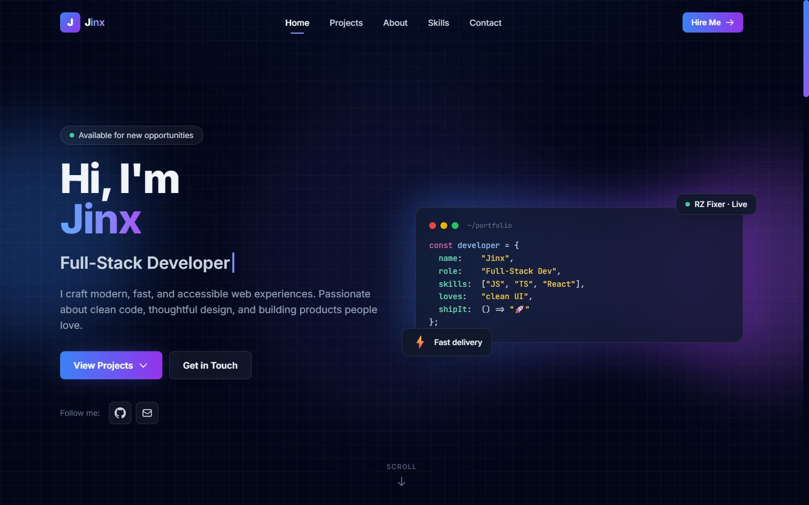

# Jinx Developer Portfolio

Personal portfolio for Jinx, a web developer. Explore my projects, the work I contributed, and the tools I use.

[Open the live portfolio](https://jinx-portfolio.pages.dev/)



## Featured projects

- **RZ Home Appliances Care** is a website for requesting appliance repairs. I built the site, connected its repair request form to the API, and set up the Docker deployment. [Live site](https://rzfixer.in/) · [Source code](https://github.com/jinx7-pixel/rz-home-appliances-care)
- **StockPilot** is an inventory and sales app. I built workflows around a PostgreSQL stock ledger so each sale records a stock movement and updates available inventory. [Source code](https://github.com/jinx7-pixel/StockPilot)

## Portfolio features

- A two-second SVG intro draws and fills the letters of JINX in sequence. The intro is skipped when the visitor prefers reduced motion.
- Responsive project cards feature screenshots from RZ Fixer and the StockPilot dashboard.
- The contact section opens the visitor’s email app or lets them copy the email address.

The portfolio uses HTML, CSS, a locally vendored Tailwind runtime, and vanilla JavaScript. Cloudflare Pages serves it as a static site with no backend, database, or build step.

## Preview locally

The local preview requires Git and Python 3.

```bash
git clone https://github.com/jinx7-pixel/jinx-portfolio.git
cd jinx-portfolio
python -m http.server 8000
```

Open [http://localhost:8000](http://localhost:8000) in your browser.

## Project files

```text
.
├── index.html       # Portfolio sections and page content
├── css/
│   ├── styles.css   # Custom design, responsive layouts, and animations
│   └── tailwind.js  # Locally vendored Tailwind runtime
├── js/
│   └── main.js      # Navigation, scroll effects, and interaction logic
└── assets/          # Illustrations, project thumbnails, and README preview
```
